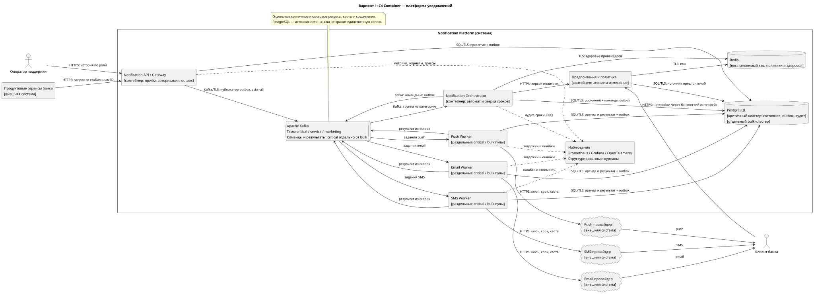
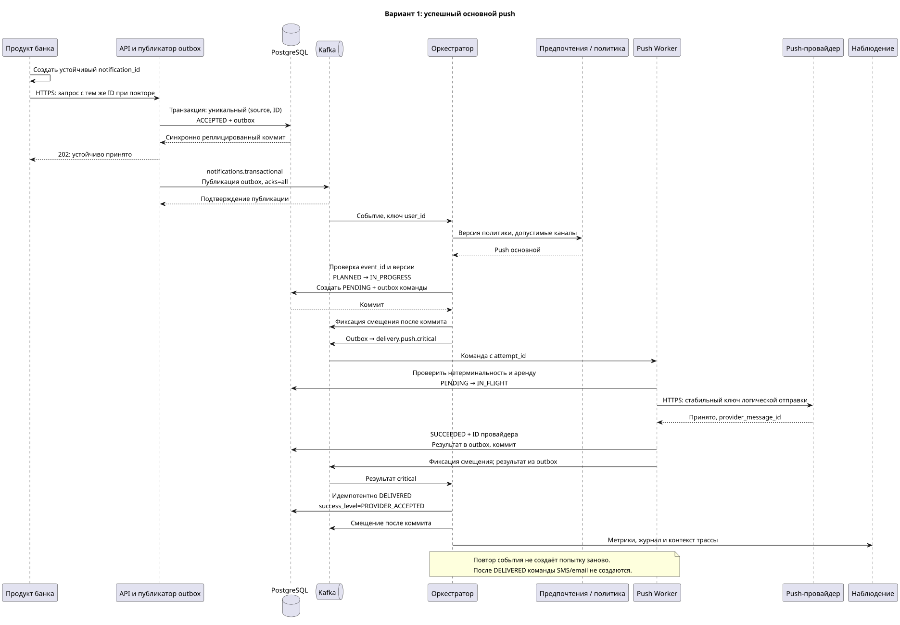
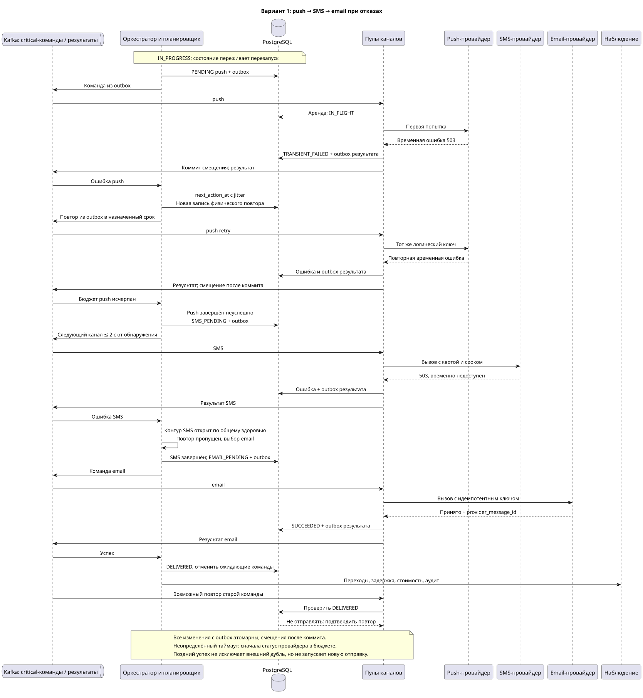
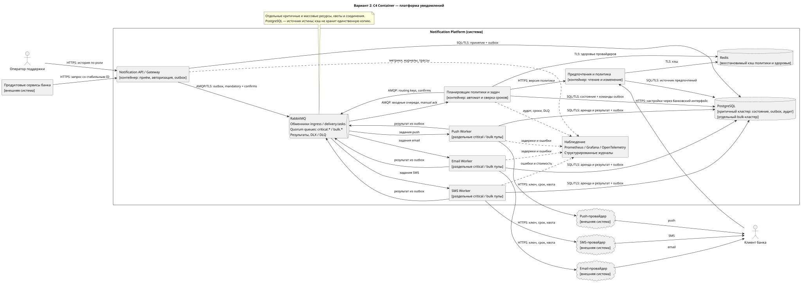
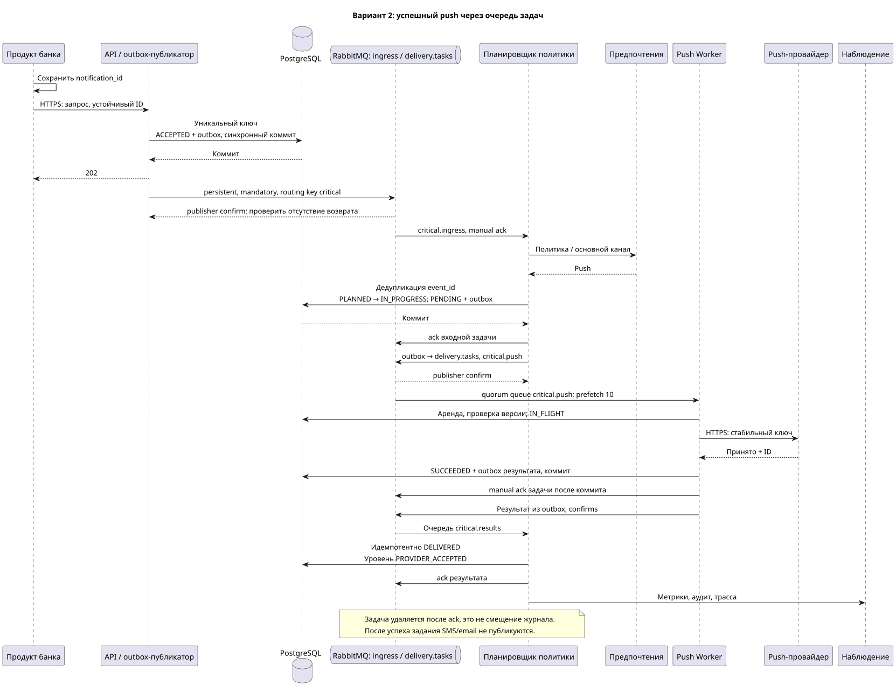
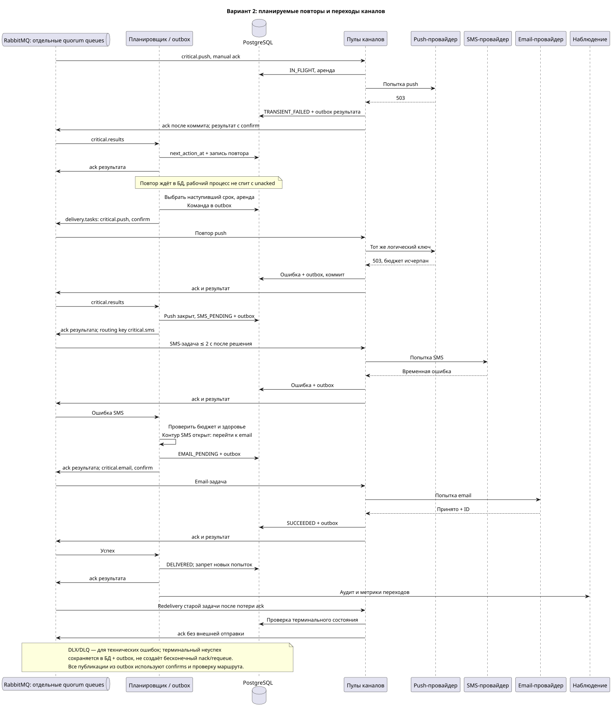

# RFC: Гарантированная доставка критичных уведомлений с кросс-канальным failover

## Метаданные

| Поле | Значение |
|---|---|
| Статус | DESIGN |
| Автор(ы) | Тен Алексей Дмитриевич |
| Ответственный | Тен Алексей Дмитриевич |
| Бизнес-заказчик | [не указан в условии] |
| Ревьюеры | [не указаны] |
| Дата создания | 2026-11-12 |
| Дата обновления | 2026-11-12 |

## Оглавление

1. [Контекст](#1-контекст)
2. [Продуктовый анализ](#2-продуктовый-анализ)
3. [Пользовательские сценарии](#3-пользовательские-сценарии)
4. [Статистика](#4-статистика)
5. [Требования](#5-требования)
6. [Варианты решения](#6-варианты-решения)
7. [Сравнительный анализ](#7-сравнительный-анализ)
8. [Выводы](#8-выводы)
9. [Связанные задачи](#9-связанные-задачи)
10. [Приложения и глоссарий](#10-приложения-и-глоссарий)

## 1. Контекст

Независимая отправка из банковских продуктов приводит к задержкам, дублям и отсутствию единой истории. Требуется одна платформа приёма, выбора каналов и контроля результата. RFC описывает гарантированную **устойчивую обработку** критичного уведомления с переходом между push, SMS и email. Системы банка отвечают за корректность бизнес-события и передачу запроса, платформа — за принятый запрос, провайдер — за внешнюю доставку согласно своему договору.

Граница гарантии начинается с ответа об устойчивом приёме. До него продукт хранит событие в собственной исходящей таблице либо ином устойчивом механизме и повторяет запрос с тем же идентификатором. Такой договор интеграции нужен, чтобы потеря запроса до API не выглядела гарантией платформы.

Не входят в объём: реализация банковских операций, рекламный редактор, выбор конкретных поставщиков, сертификация банка и подтверждение прочтения человеком. Варианты ниже — проекты, а не внедрённые системы.

## 2. Продуктовый анализ

Централизация даёт единые предпочтения, контроль частоты, историю обращений и единое поведение при отказах. Пользователь получает меньше повторов и ненужной рекламы; своевременное сообщение о списании поддерживает доверие и позволяет раньше заметить подозрительную операцию.

Рост удержания на 15% и сокращение жалоб на 30% — бизнес-цели из условия. Архитектура создаёт предпосылки, но не доказывает причинный эффект. До запуска нужно определить базовый период и способ расчёта относительного изменения, затем сравнить сопоставимые группы; обязательные сообщения безопасности не отключаются ради эксперимента.

| Заинтересованная сторона | Интерес |
|---|---|
| Продуктовые команды банка | Единый контракт приёма и статусов вместо собственных интеграций |
| Клиенты | Своевременность, понятные настройки, отсутствие лишних сообщений |
| Поддержка | Поиск истории без раскрытия лишних данных |
| Безопасность и противодействие мошенничеству | Обязательность событий и проверяемый аудит |
| Маркетинг | Охват, согласие, частотные лимиты и вовлечённость |
| Команда платформы и эксплуатации | Управляемые отказы, стоимость, диагностируемость |

Продуктовые метрики: доля успешных критичных сообщений за 60 с; p95/p99 начала первой попытки; доля дублей; жалобы на 10 000 уведомлений; доля отказов от маркетинга среди получателей; стоимость на успешное уведомление; частота переходов между каналами. Для маркетинга — доставляемость, открытия/переходы там, где канал позволяет их измерять, и целевое действие. Рост открытий не оправдывает нарушение согласия. Удержание измеряется отдельно, а не подменяется доставляемостью.

## 3. Пользовательские сценарии

MUST — обязательно для первой версии; SHOULD — желательно при запуске; COULD — последующее развитие.

| Приоритет | Сценарий и ожидаемый результат | Требования |
|---|---|---|
| MUST | Подтверждение перевода приходит через основной push, положительный ответ фиксируется; SMS/email не отправляются | FR1, FR5, FR7, FR12 |
| MUST | Push неуспешен, начинается SMS согласно срокам политики | FR6; NFR2 |
| MUST | Push и SMS неуспешны, допустимый email достигает критерия успеха | FR6; NFR4 |
| MUST | Клиент предпочитает SMS: он первый, если контакт доступен и политика разрешает; оставшиеся каналы идут без повторов | FR3, FR5 |
| MUST | Клиент отключил маркетинг, но получает обязательное сообщение о списании | FR2, FR4 |
| MUST | Отключён необязательный сервисный подтип: сообщение подавляется с причиной; обязательный подтип остаётся активен | FR3, FR10 |
| MUST | Кампания на миллион адресатов исключает отказавшихся и соблюдает лимиты, критичные сообщения сохраняют задержку | FR9, FR10; NFR7 |
| MUST | Поддержка по роли видит историю, попытки, критерий успеха и причину неуспеха | FR8; NFR10 |
| MUST | Нет доступного канала или исчерпано 60 с: DELIVERY_FAILED, поток ошибок и оповещение дежурного | FR11; NFR4 |
| SHOULD | Изменение предпочтений применяется перед фактической массовой отправкой, даже если кампания уже сформирована | FR3, FR9 |
| COULD | Панель прогноза расходов показывает эффект изменения порога перехода на SMS | FR8 |

## 4. Статистика

Даны MAU 10 млн, DAU 3 млн, пиковая одновременная активность 300 тыс. Дневной объём: 3 000 000 × (2 + 3 + 5) = 30 000 000 уведомлений.

| Категория | За сутки | В среднем за секунду |
|---|---:|---:|
| Транзакционные | 6 000 000 | 6 000 000 / 86 400 = 69,44 |
| Сервисные | 9 000 000 | 9 000 000 / 86 400 = 104,17 |
| Маркетинговые | 15 000 000 | 15 000 000 / 86 400 = 173,61 |
| Все | 30 000 000 | 30 000 000 / 86 400 = 347,22 |

Допущения: миллион адресатов за 600 с требует 1 666,67 событий/с; десятикратный транзакционный пик — 694,44/с (около 690). Наложение на прочий средний фон даёт 2 638,89/с. Поэтому выбраны цели 5 000 событий/с длительно и 10 000/с кратковременно, с запасом и изоляцией. Внутренние команды, результаты и вызовы провайдеров — отдельная, усиленная нагрузка. До 6 попыток на критичное событие дают до 4 166,67 вызовов/с при принятом пике транзакций. Дневной объём нельзя просто умножать на число каналов для обычного режима.

[Полный расчёт и оценка хранения](01_requirements_and_analysis.md#22-расчёты-нагрузки): около 48 ГБ метаданных в сутки и 4,32 ТБ за 90 дней до репликации и индексов при явно заданных размерах. Все числа ёмкости — оценки, не результаты измерения.

## 5. Требования

### 5.1. Нормативные ссылки и граница успеха

Полные FR1–FR12, NFR1–NFR11 и ASR1–ASR5 определены в [анализе](01_requirements_and_analysis.md). Этот RFC уточняет FR5–FR8, FR11–FR12. Основные цели: NFR1 p95 ≤ 1 с / p99 ≤ 2 с до первого вызова; NFR2 ≤ 2 с от обнаружения отказа до следующего канала; NFR3 ≥ 99,99% доступности; NFR4 ≥ 99,99% успешных за 60 с при нормальной доступности провайдеров; NFR5 < 0,01% дублей. Окно доставки и сроки попыток — допущения для проверки.

Для базовой политики успех означает **явное принятие провайдером с идентификатором сообщения**. Для push это передача провайдеру push, для SMS — принятие SMS-шлюзом, для email — принятие почтовой службой. В БД записывается `success_level=PROVIDER_ACCEPTED`. Если для конкретного подтипа договор требует подтверждения устройства/сети, успех наступает только по такому подтверждению, `success_level=CHANNEL_CONFIRMED`; отсутствие подтверждения до срока остаётся неопределённым исходом. Для такого подтипа отдельно проверяется достижимость 60 с.

`DELIVERED` — внутреннее имя завершения по выбранному критерию, не обещание фактического прочтения. История всегда показывает уровень подтверждения. Поздний отчёт об отказе после принятия дописывается в историю и вызывает разбор; базовый режим не начинает автоматически новую цепочку после терминального успеха. Более сильная политика должна ждать нужного отчёта до успеха. Метрики принятия и подтверждения доставки не смешиваются.

### 5.2. Политика каналов и предпочтений

Порядок по умолчанию: push → SMS → email, пропуская недоступные контакты. Допустимый предпочтительный канал перемещается в начало, остальные сохраняют порядок без повторов. Для обязательных событий безопасности банк может задать иной порядок. Политику критичности задаёт разрешённый подтип и полномочия продукта, а не произвольный флаг отправителя.

Критичную категорию нельзя отключить полностью, маркетинговый отказ и тихие часы на неё не влияют. Обязательность не создаёт отсутствующий телефон: если каналов нет, фиксируется явный неуспех. Необязательные сервисные подтипы отключаются, обязательные — по утверждённой матрице. Маркетинг отключается полностью; для него действуют тихие часы и частотные ограничения из FR10. Перед отправкой маркетинга повторно проверяется актуальное согласие: при недоступности источника отправка откладывается, а не разрешается устаревшим кэшем.

Для критичного потока используется версионированная обязательная политика; при недоступности предпочтений допускается последний известный порядок и проверенные контакты, поскольку запрет категории отсутствует. Версия и причина такого решения аудируются. Push предпочтителен при сопоставимой надёжности и задержке; после успеха другого канала SMS не нужен. Экономия SMS не отменяет обязательную доставку.

### 5.3. Устойчивое принятие и состояние

API принимает `notification_id`, `source`, `user_id`, подтип, ссылку на шаблон и минимальные параметры. Уникален `(source, notification_id)`. Идентификатор создаётся продуктом один раз на логическую операцию и повторно используется. API в одной транзакции записывает уведомление `ACCEPTED` и запись исходящей таблицы событий (outbox); только после синхронно реплицированного коммита возвращает 202. Повтор с тем же содержимым возвращает прежний идентификатор/состояние, с другим — конфликт, а не вторую отправку.

Публикатор outbox подтверждает публикацию у брокера и затем помечает запись отправленной; сбой между шагами даёт повтор события. Обработчик в одной транзакции фиксирует входное событие в таблице обработанных сообщений, меняет состояние и создаёт исходящие команды. Идемпотентность нужна также для результатов и обратных вызовов. Это закрывает окно «состояние записано, команда потеряна» без распределённой транзакции БД с брокером.

| Сущность | Состояния и переходы |
|---|---|
| Уведомление | `ACCEPTED → PLANNED → IN_PROGRESS → DELIVERED` либо `DELIVERY_FAILED`; у необязательных сообщений `SUPPRESSED` с причиной |
| Попытка канала | `PENDING → IN_FLIGHT → SUCCEEDED / TRANSIENT_FAILED / PERMANENT_FAILED / UNKNOWN` |
| Следующее действие | После TRANSIENT_FAILED — запланированный повтор или следующий канал; после PERMANENT_FAILED — следующий канал; после UNKNOWN — проверка статуса и решение по сроку; после успеха уведомления — никаких новых отправок |

`UNKNOWN` означает отсутствие достоверного ответа, а не доказанный отказ. История попытки неизменяема по смыслу: уточнение поздним ответом добавляет факт и версию. Для новой физической попытки создаётся отдельная запись; если провайдер гарантирует идемпотентность, повторы одной логической отправки используют тот же ключ `(notification_id, channel, logical_send_no)`. Смена ключа при сетевом повторе уничтожила бы эту защиту.

Одна активная логическая отправка на уведомление обеспечивается блокировкой строки/проверкой версии. У исполнителя есть аренда с номером поколения: просроченный результат не может откатить новое состояние. Уникальны `attempt_id`, `event_id` и ключ логической отправки; отдельно хранятся `provider_message_id`, номер повтора, сроки, причина, версия политики. Сам факт истечения аренды не доказывает, что внешнего вызова не было.

Процесс сверки периодически выбирает просроченные незавершённые записи и неопубликованный outbox. Целевое сканирование каждые 250 мс в исправном режиме; индекс по `next_action_at`, аренды и разделение выборок не дают всем экземплярам отправить одно задание. После сбоя экземпляра восстановление ≤ 30 с по NFR9, при этом пропущенные сроки учитываются как нарушение задержки.

### 5.4. Повторы, переходы и нестабильность провайдеров

**Retry** — повтор того же канала при временной ошибке; **failover** — переход к следующему каналу. Точные значения ниже — исходные допущения, требующие испытаний с поставщиками.

| Канал | Срок одного вызова | Повторы | Общий бюджет канала от начала | Действие |
|---|---:|---|---:|---|
| Push | ≤ 1 с | не более 1 повтора, задержка 100–200 мс | ≤ 3 с | Затем SMS либо следующий допустимый |
| SMS | ≤ 2 с | не более 1 повтора, задержка 250–500 мс | ≤ 6 с | Затем email |
| Email | ≤ 3 с | не более 1 повтора, задержка 500–1 000 мс | ≤ 8 с | Затем явный неуспех |

Задержка перед повтором — полный случайный разброс от половины до полного значения `min(cap, base × 2^n)`; при одном повторе n=0, базы 200/500/1 000 мс. Формула сохраняется при пересмотре бюджета. Общий срок уведомления 60 с включает очереди, запросы статуса и ожидание квот; новые вызовы не начинаются, если не укладываются в остаток. При быстром отказе можно начать следующий канал раньше бюджета. После обнаружения исчерпания/постоянной ошибки переход и начало следующей допустимой попытки ≤ 2 с. Если квота делает это невозможным, это нарушение NFR2 и сигнал, а не незаметное ожидание.

Невалидный токен/адрес — постоянная ошибка без повтора; контакт помечается недоступным. 429 учитывает `Retry-After`, но не превышает общий срок: при слишком большом ожидании переход к другому каналу. Ошибки 5xx допускают короткий повтор. При таймауте сначала выясняется результат по ключу/статусу в оставшемся бюджете, а не предполагается гарантированный отказ.

Для каждого провайдера: ограничитель скорости с резервом критичного потока и защитный контур (circuit breaker). Допущение: при ≥ 20 запросах за последние 10 с и ≥ 50% временных ошибок контур открывается на 5 с, затем пропускает одну пробу; успех закрывает, ошибка снова открывает. Невалидные адреса не считаются отказом провайдера. Открытый контур немедленно пропускает этот маршрут. На малом трафике мониторинг синтетических запросов дополняет статистику, но не рассылает сообщения клиентам.

Централизованные квоты, ограниченное число повторов, случайные задержки и сохранённое `next_action_at` предотвращают лавину повторов; рабочие процессы не спят с занятыми слотами. Провайдер без доступной квоты не становится бесконечной очередью. После исчерпания всех допустимых каналов или 60 с: транзакционно `DELIVERY_FAILED` и событие в DLQ/поток терминальных ошибок, оповещение дежурного с целью ≤ 30 с, запись в панели. Повтор оператором требует полномочий, причины и проверки внешнего статуса; это новое контролируемое действие, не бесконечный автоматический цикл. Падение публикации в DLQ не теряет статус: outbox будет повторно опубликован.

### 5.5. Дубли и неопределённый исход

Строгая доставка ровно один раз от начала до конца через независимых внешних провайдеров не гарантируется. Модель: обработка как минимум один раз + идемпотентные переходы + стабильный notification_id + ключи провайдера при поддержке + подавление дублей = практически однократный эффект в доступных границах.

Провайдер может принять push, а ответ потеряться. Повтор или SMS увеличивает риск дубля, отказ от повтора — риск недоставки. Сохраняем идентификатор сообщения, запрашиваем статус, повторяем с тем же поддерживаемым ключом. Если статус недоступен до срока, политика критичного сообщения выбирает продолжение доставки с риском дубля; это фиксируется как `ambiguous_failover`, отдельно измеряется. Последовательные каналы уменьшают риск по сравнению с одновременной рассылкой всем.

Перед внешним вызовом исполнитель проверяет актуальное нетерминальное состояние и свою аренду. После DELIVERED повторно полученные команды только подтверждаются, новые попытки не создаются. Уже отправленный внешний запрос отменить такой проверкой нельзя: поздний успех push может пересечься с SMS. Даже блокировка строки не делает внешнюю операцию атомарной с БД. Уведомление завершается первым подтверждённым успехом, ожидающие команды отменяются, поздние ответы добавляются в историю без новой отправки. Удалять ключи подавления дублей раньше допустимого периода повторов нельзя: после 7 дней брокера допускается управляемое воспроизведение только в пределах 90-дневного хранения состояния, более старые события блокируются для автоматической отправки.

## 6. Варианты решения

### 6.1. Вариант 1: Kafka + stateful Notification Orchestrator

#### Архитектура

**Рекомендуемый вариант.** Notification API выполняет устойчивый приём в PostgreSQL, outbox публикуется в Apache Kafka. Оркестратор применяет правила и сохраняет состояние, отдельные Push Worker, SMS Worker и Email Worker общаются с провайдерами. PostgreSQL — источник истины жизненного цикла, идемпотентности и предпочтений; компонент предпочтений обслуживает их чтение/изменение. Redis хранит лишь краткоживущие версии конфигурации, предпочтений и состояния провайдеров; потеря Redis не теряет критичные уведомления. Метрики совместимы с Prometheus, панели в Grafana, трассы через OpenTelemetry и структурированные журналы.

Входные темы: `notifications.transactional`, `notifications.service`, `notifications.marketing`. Команды: `delivery.push.critical`, `delivery.sms.critical`, `delivery.email.critical` и отдельные `delivery.push.bulk`, `delivery.sms.bulk`, `delivery.email.bulk`; сервисные необязательные идут в bulk с собственными квотами. Результаты также разделены на `delivery.results.critical` и `delivery.results.bulk`; терминальные ошибки — `delivery.dlq`. Такое количество тем нужно для изоляции не только входа, но и отправки и обратного пути.

Каждая категория обрабатывается отдельной consumer group и пулом процессов; внутри группы раздел получает один обработчик, поэтому параллелизм ограничен количеством разделов. Допущение начальной схемы — 24 раздела критичного входа и 24 массового, уточняется испытаниями. Ключ входного события — `user_id`, если требуется последовательность пользователя внутри одной темы. Это не даёт глобального порядка между темами. Команды и результаты имеют ключ `notification_id`; окончательный порядок переходов одного уведомления обеспечивает версия строки PostgreSQL, а не предположение о порядке всех внешних ответов. Строгий порядок всех банковских событий пользователя не заявляется.

Допущение развёртывания: не менее трёх брокеров в трёх зонах, replication factor 3, min.insync.replicas 2, producer acks=all и идемпотентный producer; небезопасное избрание несинхронной реплики запрещено. Удержание журнала — 7 дней. Consumer фиксирует смещение после коммита состояния, не до него. Если процесс падает после коммита, повтор безопасен. Если outbox не опубликован из-за недоступности Kafka, запрос остаётся в БД; приём может продолжаться в пределах свободного места, но задержки доставки считаются нарушенными. Бесконечное накопление запрещено: пороги ёмкости приводят к явному отказу новым запросам до подтверждения.

Сохранённый журнал удобен для воспроизведения и независимых потребителей аналитики. Воспроизведение не означает повторную отправку: таблицы идемпотентности и терминальные состояния сохраняются. Обратное давление — отставание групп, пауза массовых потребителей и ограничение выдачи кампании. Горизонтальное добавление потребителей помогает лишь до числа разделов и реальной пропускной способности БД/провайдеров.

Отдельные темы сами по себе не защищают CPU, диски и БД. Критичный поток имеет выделенные процессы, соединения, квоты и резерв производительности; массовые публикации ограничены на входе. Для критичных данных — отдельный кластер PostgreSQL с синхронной репликой и автоматическим переключением с защитой от двух ведущих; bulk-состояние — отдельный кластер. Политика и минимальная история критичных хранятся в критичном кластере. Общие Kafka-диски защищаются квотами производителей/потребителей, лимитами хранения и резервом; если испытание NFR7 не проходит, критичный брокер выносится в отдельный кластер до запуска.

[Исходник C4 Container](diagrams/option1_c4_container.puml)

[Исходник основной последовательности](diagrams/option1_main_sequence.puml)

[Исходник последовательности отказов](diagrams/option1_failover_sequence.puml)

| ASR | Механизм соответствия | Оставшееся ограничение |
|---|---|---|
| ASR1 | Реплицированный журнал, синхронная БД, outbox, сверка сроков, явный терминальный статус | Зависимость от кворума и внешних каналов; межрегиональное восстановление не определено |
| ASR2 | Критичные темы и пулы, короткие сроки, кэш политики и готовые соединения | Задержка коммитов и переключения ведущего проверяется под нагрузкой |
| ASR3 | Разделы, независимые группы и ресурсы, квоты bulk, резерв провайдера | Общий брокер остаётся ресурсным риском без испытаний изоляции |
| ASR4 | Уникальные ключи БД, версии, стабильный ключ провайдера, запрет после успеха | Таймаут внешнего вызова оставляет риск дубля |
| ASR5 | Аудит переходов, OpenTelemetry, метрики отставания и ошибок | Цена хранения полной критичной истории и защита персональных данных |

#### Этапы реализации

Сроки и состав команды — плановые допущения для обсуждения, а не измеренные обязательства по поставке. Этапы последовательны: суммарно 9–13 недель после согласования контрактов и доступа к тестовым средам провайдеров. Ресурсы — необходимые роли, не имена сотрудников; на разных этапах роли могут совмещаться.

| Этап | Описание | Планируемый срок | Ресурсы | Риски |
|---|---|---|---|---|
| 1 | Notification API, контракты событий, схема Delivery State, outbox и основа Kafka с репликацией и разделением потоков | 2–3 недели | 2 разработчика, инженер платформы; участие владельцев продуктов | Несогласованные подтипы и схемы, задержка подготовки инфраструктуры |
| 2 | Notification Orchestrator, предпочтения и политика, идемпотентность, автомат retry/failover и восстановление по срокам | 3–4 недели | 2 разработчика, инженер тестирования; участие владельца предпочтений | Гонки состояний, неоднозначные ответы, недоступность источника предпочтений |
| 3 | Адаптеры push/SMS/email, наблюдаемость, квоты, ограничители скорости и защитные контуры | 2–3 недели | 2 разработчика, инженер платформы, инженер тестирования | Разные подтверждения и ключи провайдеров, ограниченные тестовые квоты |
| 4 | Нагрузочные испытания, отказы провайдеров и узлов, проверка переключения и ограниченный пилот | 2–3 недели | Разработчики, инженер тестирования, инженер платформы; участие поддержки и безопасности | Недостижение задержек, общий ресурсный предел, дубли при потере ответа |

#### Преимущества

- Устойчивый сохраняемый журнал даёт повторное чтение и перерасчёт в пределах удержания; идемпотентность отделяет повторную обработку от повторной отправки.
- Независимые consumer groups позволяют доставке, аналитике и разбору событий двигаться со своей скоростью.
- Журнал буферизует всплески, а отдельные потоки транзакционных, сервисных и маркетинговых событий удобно изолировать при резервировании ресурсов.
- Разделы и группы дают горизонтальное масштабирование обработки в пределах ёмкости БД и провайдеров.
- Общая событийная основа подходит платформе с множеством продуктовых команд: они используют один контракт, а новые потребители не требуют менять отправителей.

#### Недостатки

- Выше эксплуатационная сложность: нужно управлять разделами, отставанием потребителей, перебалансировкой и репликацией.
- Сохраняемый журнал требует дополнительного реплицированного дискового пространства помимо состояния доставки.
- Согласование БД и брокера происходит со временем; API может подтвердить приём до появления команды в теме.
- Автомат состояний PostgreSQL, outbox и сверка сроков всё равно необходимы: журнал сам по себе не управляет внешней доставкой.
- Независимые внешние провайдеры сохраняют риск неоднозначного исхода и не позволяют обеспечить строгую доставку ровно один раз от начала до конца.

### 6.2. Вариант 2: RabbitMQ + channel task queues

#### Архитектура

Notification API использует тот же контракт приёма и PostgreSQL/outbox. Публикатор отправляет устойчивые сообщения в RabbitMQ с publisher confirms и обязательной проверкой маршрутизации (mandatory/обработка возврата); подтверждение публикации не заменяет подтверждение обработчика. Отдельный планировщик политики маршрутизирует задания в очереди каналов. Это модель задач с удалением после подтверждения, а не журнал с независимыми смещениями.

Прямой обменник `notification.ingress` направляет routing keys `critical`, `service`, `bulk` в отдельные входные очереди. Обменник `delivery.tasks` с ключами `critical.push`, `critical.sms`, `critical.email` и соответствующими `bulk.*` направляет задачи в выделенные quorum queues. Критичный и bulk-потоки имеют отдельные очереди результатов и процессы. Приоритет внутри очереди можно использовать для сервисных подтипов, но защита критичного контура основана на выделении, а не только на приоритете.

Устойчивые quorum queues, persistent messages и три узла в разных зонах выдерживают потерю одного узла при сохранении большинства. Потребитель даёт manual ack только после записи состояния и outbox результата; падение до ack приводит к redelivery. Уникальные ключи делают это безопасным. Начальный prefetch 10 для критичного исполнителя — допущение, уточняемое по задержке: слишком большой захватывает задачи медленным процессом. Bulk имеет отдельный prefetch, лимит конкурентных запросов и квоту. Канальные исполнители не держат неподтверждённую задачу, пока спят в backoff.

Повторы планирует PostgreSQL по `next_action_at`: после сохранения результата старая задача подтверждается, планировщик создаёт новую через outbox в нужный момент. Это исключает бесконечный nack/requeue и зависимость от недокументированного плагина задержек. DLX направляет технически некорректные сообщения в DLQ, а исчерпание бизнес-политики записывается транзакционно с терминальным событием. Для quorum DLX требуется настроенная надёжная передача dead-letter; состояние БД и сверка остаются страховкой от потери маршрута.

Горизонтальные конкурирующие потребители естественно распределяют задачи, но redelivery и несколько потребителей меняют порядок. Как и в варианте 1, порядок одного уведомления защищён состоянием PostgreSQL. Удалённую после ack задачу нельзя перечитать как Kafka-журнал: для повторного разбора нужны история БД и отдельный архив событий. RabbitMQ Streams мог бы дать другую модель, но это уже расширение данного варианта.

PostgreSQL критичного и bulk-контуров, резерв ресурсов и политика Redis такие же, как в варианте 1; Redis здесь необязателен. Применяются Prometheus, Grafana, OpenTelemetry и структурированные журналы. Критичные и массовые очереди разделяют кластер брокера, поэтому для него тоже нужны квоты и испытания изоляции; отдельный virtual host сам по себе не резервирует CPU или диск.

[Исходник C4 Container](diagrams/option2_c4_container.puml)

[Исходник основной последовательности](diagrams/option2_main_sequence.puml)

[Исходник последовательности отказов](diagrams/option2_failover_sequence.puml)

| ASR | Механизм соответствия | Оставшееся ограничение |
|---|---|---|
| ASR1 | Quorum queues, confirms, manual ack после коммита, outbox и сверка | Недоступность большинства останавливает выдачу; DLX требует надёжной настройки |
| ASR2 | Выделенные очереди и исполнители, малый prefetch, сроки каналов | Слишком большой prefetch ухудшает хвост задержки |
| ASR3 | Независимые critical/bulk очереди и квоты, конкурирующие потребители | Общий диск и массовый backlog требуют контроля |
| ASR4 | Те же уникальные ключи, версии и проверка терминального состояния при redelivery | Брокер не устраняет внешнюю неопределённость |
| ASR5 | Аудит БД, метрики ready/unacked, трассы и журналы | Для независимого исторического воспроизведения нужен архив |

#### Этапы реализации

Это сопоставимые с вариантом 1 плановые допущения, а не измеренные обязательства: последовательные этапы занимают 9–13 недель после согласования контрактов и доступа к тестовым средам. Роли могут совмещаться; сроки не доказывают преимущество одного брокера по скорости разработки.

| Этап | Описание | Планируемый срок | Ресурсы | Риски |
|---|---|---|---|---|
| 1 | Notification API, Delivery State DB, outbox и основа RabbitMQ с репликацией | 2–3 недели | 2 разработчика, инженер платформы; участие владельцев продуктов | Несогласованные контракты, ошибки схемы состояния, задержка инфраструктуры |
| 2 | Обменники, quorum queues critical/bulk, маршрутизация, manual ack и устойчивый планировщик | 3–4 недели | 2 разработчика, инженер платформы, инженер тестирования | Возврат немаршрутизируемых сообщений, неверные границы ack, циклы redelivery |
| 3 | Канальные адаптеры, retry/failover, DLQ, наблюдаемость, квоты и защитные контуры провайдеров | 2–3 недели | 2 разработчика, инженер тестирования; участие инженера платформы | Разные подтверждения каналов, ненадёжная настройка DLX, повторный внешний эффект |
| 4 | Смешанная нагрузка, отказ брокера/узла, повторная доставка после потери ack и ограниченный пилот | 2–3 недели | Разработчики, инженер тестирования, инженер платформы; участие поддержки и безопасности | Рост ready/unacked, исчерпание диска, нарушения изоляции и задержек |

#### Преимущества

- Естественная модель очереди задач: исполнитель получает работу и явно подтверждает её после устойчивой обработки.
- Обменники и routing keys гибко направляют задания в канальные очереди без смешения критичного и массового потока.
- Manual ack и publisher confirms дают отдельные подтверждения обработки и публикации; quorum queues обеспечивают репликацию при корректной настройке.
- Конкурирующие потребители образуют понятную модель рабочих процессов, удобную для распределения задач push/SMS/email.

#### Недостатки

- Подтверждённые задачи удаляются и не перечитываются естественным образом, как сохраняемый журнал Kafka; историческое воспроизведение требует PostgreSQL, архива или другого механизма.
- Накопление очереди и поведение ready/unacked требуют контроля диска, prefetch и медленных исполнителей.
- Планирование retry/failover всё равно требует устойчивого бизнес-состояния: ack и DLX не заменяют автомат доставки и сроки.
- Ресурсную изоляцию bulk и critical нужно проектировать отдельно; разные очереди не резервируют диски, соединения и квоты провайдеров.
- Строгая доставка ровно один раз через внешних провайдеров остаётся недостижимой. Это общее ограничение обоих вариантов, а не недостаток только RabbitMQ.

## 7. Сравнительный анализ

### 7.1. Технические свойства

| Критерий | Kafka с оркестратором | RabbitMQ с очередями |
|---|---|---|
| Надёжность | Реплики журнала, смещение после коммита, outbox | Quorum, publisher confirms, manual ack, outbox |
| Задержка критичного потока | Отдельные группы, разделы и бюджеты; нужны замеры | Отдельные очереди, малый prefetch; нужны замеры |
| Всплески | Устойчивый журнал буферизует; диск и отставание ограничены | Очередь буферизует; ready/unacked и диск ограничены |
| Кампании | Изоляция тем плюс процессов, квот и БД | Изоляция очередей плюс тех же ресурсов |
| Повторное чтение | Встроено в срок удержания, независимо по группам | После ack нужен архив/БД, обычная очередь не журнал |
| Маршрутизация | Явные темы и логика оркестратора | Обменники и routing keys удобнее для задач |
| Retry/failover | Состояние и планировщик в БД, больше протокола событий | Состояние и планировщик также нужны; ack удобен, DLX не заменяет бизнес-политику |
| Эксплуатация | Разделы, отставание, перебалансировка, реплики; больше компетенций для журнала | Quorum, prefetch, ready/unacked, маршруты и DLX; проще модель задачи, не отсутствие сложности |
| Идемпотентность | Внешний эффект защищает БД, не транзакция Kafka | Внешний эффект защищает БД, не ack RabbitMQ |
| Наблюдаемость | Лаг по группам, журнал для расследования | Глубина очереди, неподтверждённые задачи, история в БД |
| Расходы | Реплицированное хранение журнала плюс состояние | Очереди и состояние; дополнительный архив при требовании воспроизведения |
| Реализация | Потребители, outbox, оркестрация и восстановление | Маршрутизация задач проще, но та же сложная внешняя доставка |
| Навыки команды | Kafka, разделы/смещения, PostgreSQL и провайдеры | RabbitMQ, confirms/ack/DLX, PostgreSQL и провайдеры |
| Главные отказы | Потеря кворума, переполнение диска, горячий раздел, зависший outbox | Потеря кворума, переполнение очереди, неверный маршрут, цикл redelivery |

Не утверждается, что один брокер всегда быстрее другого. При данной нагрузке оба кандидата жизнеспособны; преимущество Kafka — подходящая модель общего журнала и независимой обработки, а не неподтверждённый предел сообщений/с.

### 7.2. Ресурсные требования

Начальная топология для испытаний, не окончательный расчёт серверов. CPU/RAM/IOPS определяются прототипом; нет основания приписывать им измеренную ёмкость.

| Ресурс | Вариант 1 | Вариант 2 |
|---|---|---|
| Брокер | ≥ 3 узла Kafka, реплики 3, журнал 7 дней | ≥ 3 узла RabbitMQ, quorum queues, ограниченный backlog |
| Критичное состояние | PostgreSQL: ведущий + ≥1 синхронная реплика и третий узел управления кворумом переключения, по разным зонам | То же |
| Массовое состояние | Отдельный кластер PostgreSQL; ограниченные соединения | То же |
| Рабочие процессы | ≥2 экземпляров API и оркестратора, независимые критичные и bulk-пулы каждого канала | ≥2 API и планировщика, независимые пулы по очередям |
| Кэш | Redis, восстановимый из источников истины | Необязательный Redis |
| Наблюдение | Хранилища метрик, журналов, трасс; полный аудит | То же; архив для повторного чтения отдельно |
| Внешние квоты | Резерв критичных вызовов, бюджет SMS, проверка усиления попыток | То же |

Общие параметры БД: коммит критичного состояния только после синхронной репликации, защищённое переключение ведущего, резервное копирование и испытание восстановления. Три зоны и большинство не защищают от потери региона. Длительный единичный отказ и исчерпание резерва могут потребовать отказа в новых запросах вместо ложного 202.

### 7.3. Соответствие требованиям

«Условно» означает проектный механизм с обязательным испытанием, а не уже выполненный SLO.

| Требования | Вариант 1 | Вариант 2 |
|---|---|---|
| FR1–FR6, FR10–FR12 | Покрыты политикой и состоянием | Покрыты той же политикой и состоянием |
| FR7; NFR5 | Частично: внутренние дубли подавляются, внешние остаются риском | То же |
| FR8; NFR8, NFR10, NFR11 | История, аудит и контроль доступа предусмотрены | То же; история не в удалённых задачах |
| FR9; NFR6, NFR7 | Условно: естественное разделение журнала, нужны квоты и замер | Условно: выделенные очереди, нужен контроль накопления |
| NFR1, NFR2 | Условно: короткий путь и сроки; проверка смешанной нагрузкой | Условно: настройка prefetch и сроки; та же проверка |
| NFR3, NFR4, NFR9 | Условно: кворумы, outbox, восстановление; проверить авариями | Условно: quorum/ack/outbox; проверить авариями |
| Независимое воспроизведение 7 дней | Есть в модели журнала | Не входит в обычные очереди, нужен дополнительный архив |

## 8. Выводы

Выбран **Kafka + stateful Notification Orchestrator + PostgreSQL delivery state**. Платформа обслуживает несколько категорий и команды банка, поэтому централизованный устойчивый журнал, независимое повторное чтение, буферизация всплесков и горизонтальные потребители полезнее, чем только раздача задач. Отделение транзакционного потока от маркетинга и идемпотентное состояние позволяют расширять обработку без повторной отправки старых сообщений.

Цена выбора: эксплуатация Kafka сложнее простой очереди, состояния согласуются не мгновенно, outbox и полноценный автомат доставки всё равно необходимы. Внешние провайдеры не позволяют гарантировать доставку ровно один раз, подтверждения неодинаковы, а SMS при отказе push увеличивает расход. Если потребность в журнале и независимых потребителях исчезнет, а команда уверенно работает с RabbitMQ, второй вариант может оказаться экономичнее и проще без потери основных гарантий.

Перед эксплуатацией обязательны испытания: смешанная нагрузка (час 5 000/с и всплеск 10 000/с), кампания на миллион, потеря узла брокера/БД, остановка обработчика между коммитом и ack, потеря ответа провайдера, поздний обратный вызов, отказ всех каналов и проверка терминального оповещения. Критерии — NFR1–NFR10, а не факт наличия работающих процессов. Остались неизвестны реальные квоты, цены и семантика провайдеров, правила обязательности и сроки данных; [реестр рисков](01_requirements_and_analysis.md#7-неопределённости-и-риски) задаёт способы их проверки.

## 9. Связанные задачи

Это будущий план реализации, без вымышленных номеров задач:

1. Согласовать подтипы, обязательность, контакты, подтверждения и сроки хранения.
2. Описать Notification API, права продуктов, повтор запроса и схемы событий с версиями.
3. Подготовить Kafka, разделение потоков, репликацию, квоты и пороги ёмкости.
4. Спроектировать Delivery State DB, индексы, outbox, секционирование и резервное копирование.
5. Интегрировать предпочтения, согласие, тихие часы и частотные лимиты.
6. Реализовать адаптер push и проверку его семантики подтверждения.
7. Реализовать адаптер SMS, ключи повторов, квоты и учёт стоимости.
8. Реализовать адаптер email, статусы и обработку постоянных ошибок.
9. Реализовать идемпотентность, автомат retry/failover, аренды и сверку зависших записей.
10. Подготовить аудит, метрики, трассы, панели и оповещения, контроль доступа.
11. Провести нагрузочные испытания, испытания отказов и восстановление резервной копии.
12. Запустить ограниченный пилот и оценить продуктовые метрики, стоимость и жалобы.

## 10. Приложения и глоссарий

### 10.1. Наблюдаемость

| Метрика | Смысл |
|---|---|
| `notification_ingest_total` | Устойчиво принятые уведомления |
| `notification_delivery_success_total` | Завершения по критерию успеха; разрез по уровню подтверждения |
| `notification_delivery_failure_total` | Явные терминальные неуспехи |
| `notification_failover_total` | Переходы на следующий канал, в том числе из неопределённого исхода |
| `notification_duplicate_total` | Обнаруженные дубли, с указанием метода обнаружения |
| `provider_request_latency_seconds` | Гистограмма времени внешнего вызова |
| `provider_error_rate` | Вычисляемая доля ошибок за окно из счётчиков запросов/ошибок |
| `delivery_end_to_end_latency_seconds` | Время от устойчивого приёма до успеха, срез по уровню подтверждения |
| `broker_consumer_lag` | Для Kafka — отставание групп; для RabbitMQ — число ready/unacked как отдельные ряды с типом |
| `dlq_size` | Необработанные терминальные события и технические ошибки |
| `sms_fallback_cost` | Накопленная оценка стоимости SMS-переходов в согласованной валюте |

Дополнительно нужны гистограмма времени до первой попытки, время от отказа до следующего канала, возраст outbox и число просроченных состояний: только успешные доставки скрыли бы зависшие. Допустимые метки: категория, канал, провайдер из фиксированного списка, класс результата, уровень успеха, среда. Нельзя использовать user_id/notification_id/произвольный текст ошибки как метки метрик. Идентификаторы находятся в защищённых журналах и трассах, персональные данные маскируются.

Панели: p95/p99 начала и завершения, успех по каналам и уровням, частота переходов, ошибки провайдеров, отставание и возраст очереди, дубли, объём и стоимость SMS. Сигналы: нарушение сроков, любое терминальное критичное событие, отсутствие прогресса outbox, рост DLQ и скорость расходования бюджета доступности. Агрегирование оповещений предотвращает лавину при общем отказе, но не удаляет отдельные записи неуспеха.

### 10.2. Безопасность и данные

TLS между сервисами и к провайдерам, шифрование чувствительных данных на диске, секреты вне исходного кода с ограничением доступа и ротацией. Авторизация сервиса проверяет доступные ему подтипы, оператору история доступна по роли и служебной необходимости. Проверяются подпись/подлинность обратных вызовов, защита от повторной обработки и соответствие provider_message_id попытке.

В брокере — идентификатор, подтип, версия шаблона и минимальные параметры; телефон, email и полный текст не дублируются в каждом событии. Ссылка на защищённое содержимое должна оставаться разрешимой весь допустимый срок доставки. Аудит административных действий и переходов критичного состояния защищён от редактирования обычными исполнителями. Сроки 7/90 дней из NFR11 — допущения, подлежащие согласованию; удаление включает кэш, журналы и регламент резервных копий. Конкретные банковские сертификаты не предполагаются.

### 10.3. Глоссарий

| Термин | Значение |
|---|---|
| Notification Platform | Централизованная платформа приёма, маршрутизации и контроля уведомлений |
| Критичное уведомление | Обязательное сообщение о транзакции или безопасности, которое нельзя полностью отключить |
| Failover | Переход к следующему допустимому каналу после отказа или истечения бюджета |
| Retry | Ограниченный повтор той же логической отправки в том же канале |
| Идемпотентность | Повтор операции с тем же ключом не создаёт новый логический эффект |
| At-least-once | Доставка на обработку как минимум один раз; возможны повторы |
| Effectively-once | Практически однократный эффект за счёт подавления повторов в контролируемых границах |
| DLQ | Очередь или поток сообщений, требующих разбора после ошибок/исчерпания политики |
| SLA | Соглашение об уровне услуги и ответственности сторон |
| SLO | Целевой измеримый уровень качества; здесь проектные цели, ещё не договор |
| p95 / p99 | Задержка, не превышаемая соответственно 95% / 99% наблюдений |
| Брокер | Система хранения и передачи сообщений обработчикам |
| Consumer group | Группа потребителей Kafka, совместно читающих разделы темы |
| Circuit breaker | Защитный контур, временно прекращающий вызовы неработающего провайдера |
| Кэш | Восстановимая копия данных для ускорения доступа, не источник истины |
| Подтверждение провайдера | Ответ о принятии или доставке, смысл которого зависит от договора канала |
| Outbox | Исходящая таблица событий, записываемая атомарно с бизнес-состоянием |
| Обратное давление | Ограничение приёма/обработки при исчерпании ресурсов вместо неограниченного накопления |
